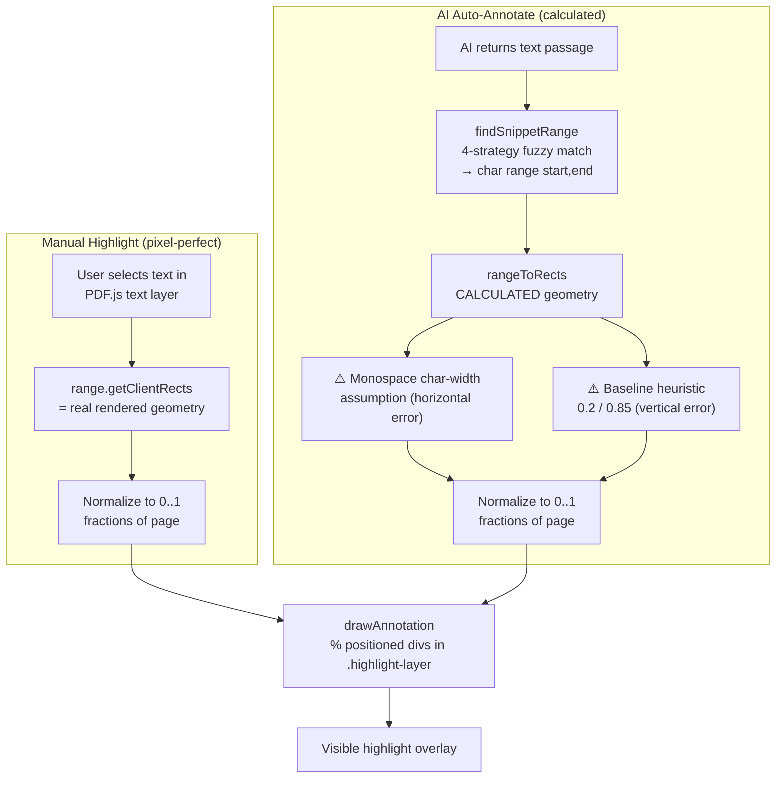

Now I want a resource to call local Ollama AI service:

The prompt will be an textarea template text with placeholder using $ notation: $text
This $text will be replaced by the PDF context, options: selectedText, entirePage(s) (user will decide the amount since the actual page)

Other feature will be create annotations automatically on the selected page(s) since the actual page, the prompt to AI will be to find the more important parts of that page content creating annotations. Options: howManyDesiredAnnotations (nullable)
--- Future
Other placeholder will be $annotation (w)
--- Plan
I've written the Ollama integration plan to plans/ollama-integration-plan.md. Here's the summary:

Plan Summary
Two AI features, calling local Ollama directly from the browser via fetch (same API as your Tauri app, minus the Rust CORS bypass):

Feature 1: AI Prompt Panel
Collapsible drawer with Ollama settings (host, model + fetch-models dropdown, maxTokens, numCtx, reasoning, streaming) — persisted in localStorage.
Prompt template textarea with $text placeholder.
Context scope selector: selectedText / entirePage / entirePages (current page + N pages).
Streams the response into a response area (with dimmed thinking section).
Feature 2: Auto-Annotate
AI analyzes page content and returns strict JSON of important passages.
User options: howManyDesiredAnnotations (nullable — AI decides if empty) and includeNotes (checkbox — snippets only vs snippets + notes).
Each AI snippet is fuzzy-matched back to the page text → converted to normalized rects → creates highlight annotations with notes as annotationText.
New modules
js/ollama.js — fetch-based client (listModels, streaming chat via ReadableStream, AbortController cancel)
js/ai-panel.js — panel UI, settings, context gathering, $text substitution
js/auto-annotate.js — JSON prompt, fuzzy matching, auto-create annotations
js/text-geometry.js — shared text→rect helper (refactored from Search)
⚠️ Key requirement: CORS
Since there's no Rust backend, Ollama must be started with OLLAMA_ORIGINS=* (documented in README + shown as an error hint in the UI if the connection fails).

9-step todo list covering: ollama client → HTML → CSS → AI panel → text-geometry refactor → auto-annotate → wiring → README → testing.
---
Can you add on the AI response an option to see the result output in other formats viewer: textViewer (actual), markdownViewer
---
On debug output I'm getting:
REQ 22:13:59.953 Page 59: POST http://localai:11001/api/chat | model=qwen3.5:2b | promptLen=2284

I would like to have the entire content of the request body too
---
Can you add a feature optional advanced features:

- System prompt: Sent as a role: system message before the user prompt when using /api/chat.
- 
--- Future (niy)
Can you add queue actions to AI, as they has some time to be answered by Ollama service the user.
And add a sound to be played while each action queued is completed.
---
Can you add a feature optional advanced features:

- Let the user modify the template of prompt to Auto-Annotate:

*You can add placeholders instead of the actual variables on this part

Now it is:

You are analyzing the text content of a PDF page.\nIdentify the most important passages worth highlighting.\nReturn the most important passages (as many as you judge relevant).\n\nCRITICAL RULES:\n1. The \"text\" value MUST be copied VERBATIM from the page text below (do not paraphrase, do not summarize).\n2. Return ONLY a JSON array. No markdown fences, no commentary, no prose.\n3. Each element MUST be: {\"text\": \"<exact excerpt copied verbatim from the page>
--- Output AI
[{"text": "fundou em 387 a Academia", "reasoning": "This marks the pivotal moment when Plato established his philosophical institution, laying the foundation for what became the Academy."}, {"text": "estudou com os ensinos eleáticos e pitagóricos através de Platão", "reasoning": "Contextualizes the influence of other schools on Plato's life and philosophy before he founded the academy."}]
---
Can you add I18N with support to brazilian portuguese and english

*Don't forget to change the default prompt texts that we give to AI
*The placeholders can be kept in english to maintain uniform
---
I'm having problems with the AI answer sometimes it uses more or less ponctuation what make it harder to find the matched part on text to auto-annotate feature

Can you add a fallback as another try to match the text? I was thinking about to use some code to strip both the pdf text and ai response text and verify the matched words and tolerate some percentual of differences

Example on what didn't matched:

Pdf Text:
OS MISTÉRIOS\nDO TIBET\nDhâranâ é um estado de perfeita concentração da mente na\nessência espiritual.

AI Response:
O TIBET - Os mistérios do Tibete\": Dhâranâ é um estado de perfeita concentração da mente na essência espiritual.
---
I've created a detailed plan at plans/fuzzy-matching-fallback-plan.md. Here's a summary:

Problem
The current findSnippetRange() in text-geometry.js has 3 matching strategies, all of which fail when the AI response has:

Extra punctuation (quotes, dashes, colons)
AI-added prefixes like "O TIBET - Os mistérios do Tibete": before the actual passage
Minor spelling differences (tibet vs tibete)
The root cause: normalize() only lowercases and collapses whitespace — it does not strip punctuation, so any punctuation difference breaks the match.

Solution: Strategy 4 — Punctuation-Stripped Fuzzy Word Matching
A new fallback that runs only when Strategies 1–3 all fail:

Strip all punctuation from both PDF text and AI snippet (keeping Unicode letters/numbers only)
Tokenize into word arrays with position mappings back to original text
Greedy word alignment with:
Fuzzy word comparison via Levenshtein distance (20% character tolerance)
Skip tolerance for AI-added prefix/suffix noise (30% skip budget)
Accept if ≥50% of AI words match (minimum 3 words)
All changes go in js/text-geometry.js only — no other files need modification since auto-annotate.js already calls findSnippetRange().

The performance impact is negligible (~600K simple operations worst case, <1ms).


Checkpoint
(Current)

Kilo Code has a question
01:33 PM
Are you satisfied with this plan, or would you like to adjust anything before I switch to Code mode to implement it?

Looks good, proceed to implementationcode
Also fix the malformed JSON parsing issue in parsePassages()architect
Adjust the thresholds (50% match, 20% word tolerance)architect
Add diacritic stripping for even more tolerant matching
---
I've added a Strategy 4: Punctuation-stripped fuzzy word matching fallback to findSnippetRange() in js/text-geometry.js. This was the only file changed — auto-annotate.js already calls findSnippetRange() and will automatically benefit from the new fallback.

What was added
5 new functions inside the TextGeometry module:

Function	Purpose
stripPunctuation()	Removes all non-letter/non-number characters using Unicode property escapes (\p{L}, \p{N}, \p{M}), preserving accented characters like ã, é, ç
tokenizeWithPositions()	Splits text into word tokens while tracking each token's original character offsets (for highlight rect mapping)
levenshtein()	Standard O(n) rolling-array edit distance for fuzzy word comparison
wordsSimilar()	Returns true if two words match exactly or within 20% character-edit tolerance; requires exact match for words ≤2 chars to avoid false positives on common articles (de/da, os/o)
findSnippetRangeStripped()	The core Strategy 4 — strips punctuation from both texts, then uses greedy word alignment with skip tolerance
How it works
When Strategies 1–3 all fail, Strategy 4:

Strips all punctuation from both the PDF text and AI snippet
Tokenizes both into word arrays with position mappings
Greedy alignment: slides through PDF words, matching against AI words using fuzzy comparison (handles tibet vs tibete) with a skip budget of 30% to tolerate AI-added prefixes/suffixes
Accepts if ≥50% of AI words match (minimum 3 words)
Configurable thresholds
All thresholds are named constants at the top of the module (lines 9–13) for easy tuning:

FUZZY_WORD_TOLERANCE = 0.2 — 20% character difference allowed per word
MIN_MATCH_SCORE = 0.5 — 50% of AI words must match
MIN_MATCHED_WORDS = 3 — minimum absolute word count
MAX_SKIP_RATIO = 0.3 — 30% skip budget for prefix/suffix noise
The design plan is documented at plans/fuzzy-matching-fallback-plan.md.
---
## How Annotation Positioning Works

Your app has **two completely different code paths** for computing annotation rectangles, and they produce different levels of accuracy. This is the root of your pixel-perfect mismatch.

---

### Path 1 — Manual Highlights (pixel-perfect)

When a user selects text, [`onHighlightClick()`](js/highlighter.js:126) runs. It reads the **browser's own rendered geometry** from the PDF.js text layer:

```js
for (const r of range.getClientRects()) {
  const localX = r.left - wrapperRect.left;
  const localY = r.top - wrapperRect.top;
  const nx = localX / wrapperRect.width;   // fraction of page
  const ny = localY / wrapperRect.height;
  ...
  rects.push({ x: nx, y: ny, width: nw, height: nh });  // normalized 0..1
}
```

This is **pixel-perfect** because `getClientRects()` returns the actual on-screen positions of the transparent text-layer spans that PDF.js positioned using real glyph metrics. The result is stored as fractions of the page (0..1).

---

### Path 2 — AI Auto-Annotations (calculated, NOT pixel-perfect)

When the AI returns a text passage, the position is **calculated from PDF metadata**, never from the rendered text layer. The pipeline is:

1. **Build a text index** — [`buildIndex()`](js/text-geometry.js:21) concatenates all `textContent.items` into one big string, keeping a `charMap` that maps each character back to its source PDF text item.

2. **Find the matching range** — [`findSnippetRange()`](js/text-geometry.js:204) uses a 4-strategy cascade (exact substring → anchor words → sliding window → fuzzy Levenshtein word matching) to locate the AI's snippet inside the indexed page text. This returns a `{start, end}` character range.

3. **Convert range → rectangles** — [`rangeToRects()`](js/text-geometry.js:59) is where the **position is actually computed**. This is the problematic function.

---

### The Rendering (shared by both paths)

[`drawAnnotation()`](js/highlighter.js:185) takes the normalized `{x, y, width, height}` fractions and renders them as percentage-positioned divs inside the `.highlight-layer` (which is `position: absolute; inset: 0` over the page). Since both paths store fractions and render identically, the rendering layer itself is not the problem.

---

## Where the Pixel-Perfect Mismatch Comes From

The mismatch lives entirely inside [`rangeToRects()`](js/text-geometry.js:59). Here are the specific sources of error:

### 1. Monospace character-width assumption (biggest horizontal error)

```js
const charW = item.width ? item.width / len : 0;   // line 77
const x0 = baseX + lo * charW;                      // line 81
const x1 = baseX + (hi + 1) * charW;                // line 82
```

`item.width` is the total width of the **entire text run** (sum of real glyph advances). Dividing by `len` gives the **average** character width. It then assumes every character is that wide — a monospace model. For proportional fonts (most PDFs), narrow letters like `i`, `l`, `t` are over-estimated and wide letters like `m`, `w` are under-estimated. The highlight's left/right edges drift proportionally to how far into the run the match sits.

### 2. Vertical baseline heuristic (top/bottom error)

```js
const h = item.height || Math.hypot(t[0], t[1]) || 10;          // line 80
const vr = vp.convertToViewportRectangle([
  x0, baseY - h * 0.2,    // top    — line 83
  x1, baseY + h * 0.85    // bottom — line 83
]);
```

`baseY` (`item.transform[5]`) is the **text baseline** in PDF coordinates, not the top of the glyph. The code guesses the visual box by subtracting `h * 0.2` for the top and adding `h * 0.85` for the bottom. These magic constants (0.2 / 0.85) are approximations — real glyph ascenders/descenders vary by font, so the highlight box is often too tall, too short, or vertically shifted relative to the visible text.

### 3. `item.height` may not equal visual glyph height

`item.height` comes from PDF.js and represents the font size metric, but it doesn't always correspond to the actual ink height of the rendered glyphs (especially with fonts that have unusual metrics or embedded subsets).

---

## Visual Summary



---

## Key Takeaway

**Manual highlights are pixel-perfect** because they read the browser's actual rendered text geometry. **AI annotations are not**, because [`rangeToRects()`](js/text-geometry.js:59) reconstructs positions mathematically from PDF text-item metadata using two lossy approximations:

| Source | What's wrong | Affects |
|---|---|---|
| `charW = item.width / len` | Assumes uniform character width | Horizontal position & width |
| `baseY ± h * {0.2, 0.85}` | Guesses glyph box from baseline | Vertical position & height |

If you want AI annotations to be as accurate as manual ones, the fix would be to use PDF.js's per-character glyph widths (available in newer `getTextContent` with `includeMarkedContent` / `disableNormalization`, or via the text-layer span geometry) instead of the average-width model — essentially making the AI path use the same real geometry that the manual path gets for free from `getClientRects()`.
---
Now can you add a new AI Feature that will read the page range selected and return a text in topics like a Mindmap using 4 spaces identation and let the user input optionally how many levels of topics he wants to limit.
To each request send the actual "Mindmap of topic in plain text" to the AI can complete it on the response. (Show on debug one message with the actual Mindmap)

Example of output:
Central topic
    Topic 1
    Topic 2
        Topic 2.1
---
Can you add an option to send all pages in one prompt or give each page at once on iterating page per page and retriving and improving the actual mindmap built to be improved on the next page iteraction
---
Como viver na prática os ensinamentos do texto abaixo:

$text
---