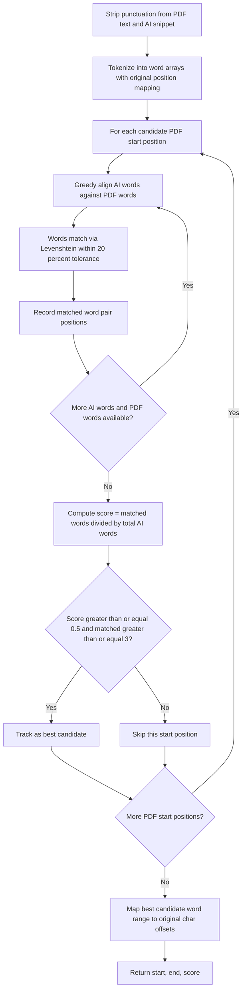
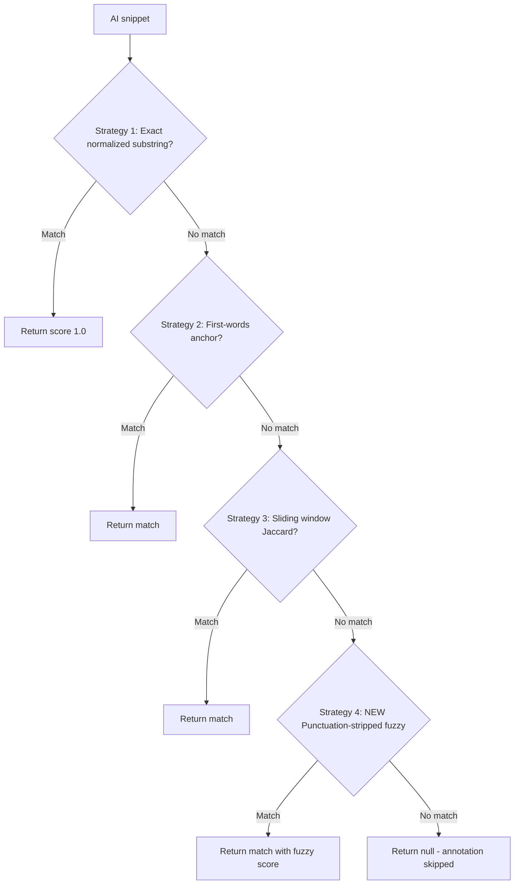

# Plan: Punctuation-Stripped Fuzzy Matching Fallback

## Problem Analysis

When the AI returns passages for auto-annotation, the text often differs from the PDF source due to:

1. **Extra punctuation** — quotes, dashes, colons, parentheses wrapping the passage
2. **AI-added prefixes/suffixes** — e.g., heading text prepended: `"O TIBET - Os mistérios do Tibete": Dhâranâ é um estado...`
3. **Minor spelling differences** — e.g., `Tibet` vs `Tibete`, `Descendia` vs `Descendía`
4. **Capitalization differences** — `OS MISTÉRIOS` vs `Os mistérios`

The current [`findSnippetRange()`](js/text-geometry.js:111) in [`text-geometry.js`](js/text-geometry.js) uses three strategies, all of which fail in these scenarios:

| Strategy | Why it fails |
|----------|-------------|
| 1. Exact normalized substring | `normalize()` only lowercases + collapses whitespace — does NOT strip punctuation. Extra punctuation breaks exact match. |
| 2. First-words anchor | AI's first words (`"O TIBET - Os mistérios..."`) don't appear contiguously in the PDF, so the anchor never matches. |
| 3. Sliding window Jaccard | Character-length window doesn't align with word boundaries; Jaccard set overlap loses word order; punctuation inflates word differences. |

### Concrete Example

```
PDF Text:
OS MISTÉRIOS\nDO TIBET\nDhâranâ é um estado de perfeita concentração da mente na\nessência espiritual.

AI Response:
O TIBET - Os mistérios do Tibete": Dhâranâ é um estado de perfeita concentração da mente na essência espiritual.
```

After stripping punctuation, the core passage `dhârana é um estado de perfeita concentração da mente na essência espiritual` (12+ words) exists verbatim in both. A word-level matcher would easily find this.

## Solution: Strategy 4 — Punctuation-Stripped Fuzzy Word Matching

Add a **fourth fallback strategy** inside [`findSnippetRange()`](js/text-geometry.js:111) that only runs when Strategies 1–3 all fail. It works in three phases:

### Phase 1: Strip & Tokenize

Strip ALL punctuation from both the PDF full text and the AI snippet, keeping only Unicode letters (`\p{L}`), numbers (`\p{N}`), and combining marks (`\p{M}`). Tokenize into word arrays where each token records its position in the **original** text (for later rect mapping).

```
Input:  "O TIBET - Os mistérios do Tibete\": Dhâranâ é um estado..."
Tokens: [{word:"o",start:0,end:1}, {word:"tibet",start:2,end:7}, {word:"os",start:10,end:12}, ...]
```

### Phase 2: Greedy Word Alignment

For each candidate starting position in the PDF word array, greedily align the AI words against PDF words using:

- **Fuzzy word comparison** via Levenshtein distance — two words match if edit distance ≤ `ceil(maxLen × 0.2)` (20% character tolerance). This handles `tibet` vs `tibete`, `descendia` vs `descendía`.
- **Skip tolerance** — when words don't match, allow skipping up to 1–2 PDF words (gap in PDF) or AI words (noise from AI), up to a total skip budget of 30% of AI word count. This handles AI-added prefixes/suffixes.



### Phase 3: Map Back & Return

The best-scoring alignment gives us a range of PDF word tokens. Map the first and last matched token's `origStart`/`origEnd` back to character offsets in the original PDF text, and return `{ start, end, score }` — the same format as the existing strategies.

### Overall Matching Flow



## Implementation Steps

All changes are in [`js/text-geometry.js`](js/text-geometry.js) only. No other files need modification — [`auto-annotate.js`](js/auto-annotate.js:126) already calls `TextGeometry.findSnippetRange()`, which will automatically use the new fallback.

### Step 1: Add `stripPunctuation(text)` helper

New function that removes all non-letter/non-number/non-mark characters, collapses whitespace, and lowercases. Uses Unicode property escapes: `/[\p{L}\p{N}\p{M}]/u`.

### Step 2: Add `tokenizeWithPositions(text)` helper

New function that iterates the original text character-by-character, groups consecutive letter/number/mark characters into words, and returns an array of `{ word, origStart, origEnd }` objects. The `word` field is lowercased. The `origStart`/`origEnd` fields point into the **original** text so we can map back later.

### Step 3: Add `levenshtein(a, b)` helper

Standard O(m×n) dynamic programming edit distance. Words are short (typically <15 chars), so this is negligible cost.

### Step 4: Add `wordsSimilar(a, b)` helper

Returns `true` if two stripped words are identical OR if their Levenshtein distance ≤ `ceil(max(a.length, b.length) × 0.2)`. The 20% tolerance handles single-character spelling differences.

### Step 5: Add `findSnippetRangeStripped(idx, snippet)` — the core Strategy 4

Algorithm:
1. Call `tokenizeWithPositions()` on both `idx.full` and `snippet`
2. If AI has fewer than 3 tokens, return null (too short for reliable fuzzy matching)
3. For each starting position `pi` in the PDF token array:
   - If `pdfTokens[pi].word` doesn't match any of the first few AI tokens via `wordsSimilar()`, skip (optimization)
   - Run greedy alignment: walk both arrays forward, counting matches via `wordsSimilar()`, allowing skips
   - Track score = `matched / aiTokens.length`
   - If score ≥ 0.5 and matched ≥ 3, track as candidate
4. Return the best candidate mapped to original char offsets, or null

### Step 6: Wire Strategy 4 into `findSnippetRange()`

At the end of [`findSnippetRange()`](js/text-geometry.js:111), after Strategy 3 returns null, add:

```javascript
// 4) Punctuation-stripped fuzzy word matching (fallback)
return findSnippetRangeStripped(idx, snippet);
```

### Step 7: Export `stripPunctuation` from the module

Add to the return object for potential reuse and testing.

## Thresholds & Constants

| Constant | Value | Rationale |
|----------|-------|-----------|
| `FUZZY_WORD_TOLERANCE` | 0.2 (20%) | Allows 1-char difference in 5-char words (e.g., `tibet` vs `tibete`) |
| `MIN_MATCH_SCORE` | 0.5 (50%) | Half the AI words must match — prevents false positives on short common phrases |
| `MIN_MATCHED_WORDS` | 3 | Minimum absolute word count to avoid matching trivial conjunctions |
| `MAX_SKIP_RATIO` | 0.3 (30%) | Skip budget as fraction of AI word count — handles AI prefix/suffix noise |

These will be defined as named constants at the top of the IIFE for easy tuning.

## Performance Analysis

- PDF page text: ~300 words
- AI snippet: ~15–20 words
- For each of ~300 PDF positions: greedy alignment walks ~20 AI words, each with a Levenshtein call on ~10-char words
- Worst case: 300 × 20 × (10×10) = 600,000 operations
- This completes in <1ms on any modern browser — negligible overhead

## What This Does NOT Fix

- **Malformed JSON from AI** — many failures in the debug logs show `parsed 0 passage(s)` because the AI returns invalid JSON (mixed quote types, escaped quotes). This is a separate issue in [`parsePassages()`](js/auto-annotate.js:184) and is out of scope for this plan.
- **Completely paraphrased passages** — if the AI rewrites the text entirely (e.g., "Agatão reclina-se ao lado de Sócrates..." instead of the original), no matching strategy will find it. The fuzzy matcher requires at least 50% word overlap.

## Files Changed

| File | Change |
|------|--------|
| [`js/text-geometry.js`](js/text-geometry.js) | Add 5 new functions + wire Strategy 4 into `findSnippetRange()` |

No changes needed to `auto-annotate.js`, `app.js`, or any other file — the new strategy is transparently used as a fallback.
