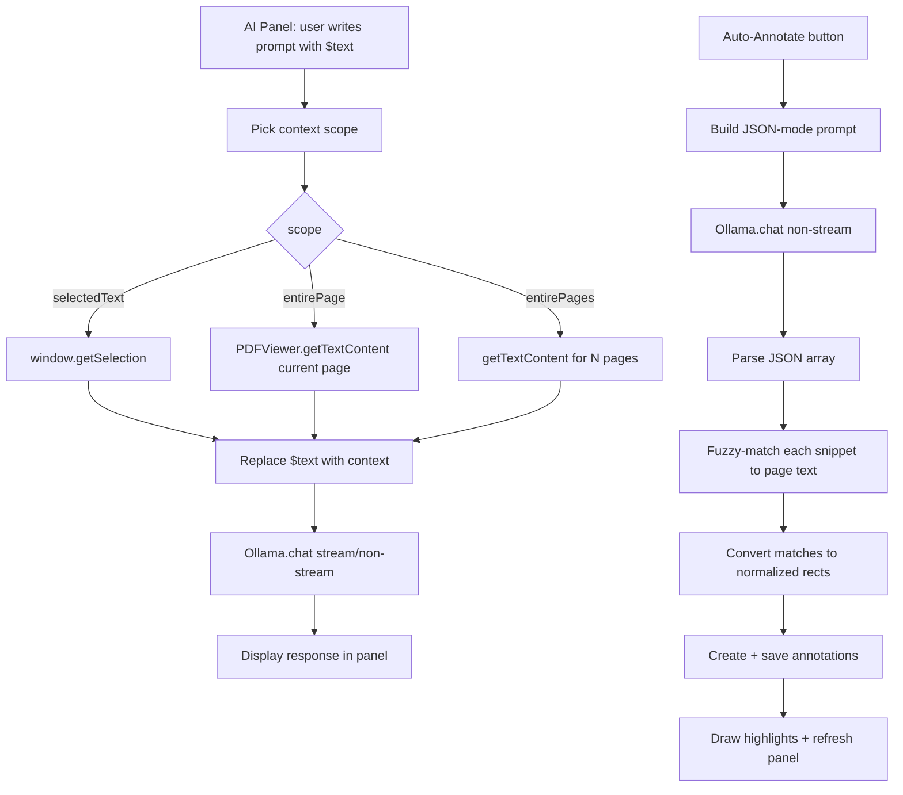

# Ollama AI Integration — Architecture & Plan

## Goal
Add two AI-powered features to the PDF annotations app, calling a **local Ollama** instance
directly from the browser (no backend, consistent with the "no server" requirement).

1. **AI Prompt Panel** — user writes a prompt template with a `$text` placeholder, picks the
   PDF context scope (selected text / entire page / multiple pages from current), sends to
   Ollama, and views the streamed response.
2. **Auto-Annotate** — AI analyzes page content, returns the most important passages, and the
   app automatically creates highlight annotations (with optional notes) at the matched locations.

## Reference: Ollama API (from the Tauri app at `C:\Dev\tauriExample\tauri-app-ai-client`)
The Tauri app calls Ollama through a Rust backend (to bypass CORS). We replicate the same API
calls directly via `fetch`:

| Endpoint | Method | Body |
|---|---|---|
| `{host}/api/chat` | POST | `{model, messages:[{role,content}], stream, options:{num_predict,num_ctx}, think}` |
| `{host}/v1/models` | GET | — (returns `{data:[{id}]}`) |
| `{host}/api/embed` | POST | `{model, input}` (not needed for v1) |

- **Streaming**: Ollama returns NDJSON (one JSON object per line). Each chunk has
  `message.content` (chat endpoint) and optional `thinking`.
- **Non-streaming**: single JSON response with the full `message.content`.

## ⚠️ CORS Requirement (critical for browser-only)
Ollama only allows requests from `127.0.0.1` by default. A browser page served from
`localhost:8123` (or `file://`) will be **blocked by CORS** unless Ollama is started with:
```
OLLAMA_ORIGINS=* ollama serve
```
(Windows: `set OLLAMA_ORIGINS=* && ollama serve`)
This will be documented in a README and shown as a hint in the AI panel.

## New Files
```
js/
├── ollama.js           # Ollama API client: fetch models, chat (stream/non-stream), cancel
├── ai-panel.js         # AI Prompt Panel UI: settings, template, context scope, response
└── auto-annotate.js    # Auto-annotate: build prompt, parse AI JSON, fuzzy-match, create anns
```

## Module: `js/ollama.js`
Pure fetch-based client. No dependencies. Exposes global `Ollama`.

```
Ollama.listModels(host)                     -> Promise<string[]>
Ollama.chat({host, model, messages, stream, options, think, onChunk, onThinking, signal})
                                            -> Promise<string>  (full text)
Ollama.abort(controller)                    -> void
```

- Uses `AbortController` for cancellation (replaces the Tauri `CancelFlag`).
- Streaming: reads `response.body.getReader()`, buffers bytes, splits on `\n`, parses each
  NDJSON line, extracts `message.content` / `thinking`, calls `onChunk` / `onThinking`.
- Non-streaming: parses the single JSON response.
- Settings persisted in `localStorage` (key `pdf-ann-ai-settings`):
  `host, model, maxTokens, numCtx, reasoning, streaming`.

## Module: `js/ai-panel.js`
A collapsible panel (toggle button in toolbar). Contains:

1. **Settings section** (collapsible):
   - Host input (default `http://localhost:11434`)
   - Model input + "Fetch Models" button → dropdown
   - maxTokens, numCtx inputs
   - Reasoning (checkbox), Streaming (checkbox)
2. **Prompt template** textarea with `$text` placeholder.
   - Helper text: "Use `$text` where the PDF context goes."
   - Save/load template presets (localStorage, like the Tauri app).
3. **Context scope** selector:
   - `selectedText` — uses current text selection (or falls back to page if none)
   - `entirePage` — full text of the current page
   - `entirePages` — current page + N pages (number input for count)
4. **Send / Stop** buttons.
5. **Response area** — shows streamed text (and thinking in a dimmed sub-area).

### Context gathering
Reuses `PDFViewer.getTextContent(page)` → joins text items into a string. For multi-page,
concatenates with `\n\n--- Page N ---\n\n` separators.

## Module: `js/auto-annotate.js`
A button "AI Annotate" in the AI panel (or toolbar). Flow:

1. **Gather context**: current page(s) text (same as AI panel context scope).
2. **Build prompt**: instructs the AI to return **strict JSON** identifying important passages.
   - User option: `howManyDesiredAnnotations` (nullable number input — if empty/null, AI decides).
   - User option: `includeNotes` (checkbox — if checked, AI returns `{text, note}` pairs;
     if unchecked, only `{text}`).
3. **Call Ollama** (non-streaming for reliable JSON parsing; or streaming then parse at end).
4. **Parse JSON**: extract array of `{text, note?}`.
5. **Fuzzy-match** each snippet to the page text → locate char ranges.
6. **Convert** char ranges to normalized rects (reuses `Search` module's geometry logic).
7. **Create annotations** via `Highlighter` + `Storage` (same path as manual highlights).
8. **Draw** highlights immediately + refresh side panel.

### AI prompt for auto-annotate (JSON mode)
```
You are analyzing a PDF page. Identify the most important passages.
Return ONLY a JSON array, no markdown, no explanation.
Each element: {"text": "<exact excerpt from the page>", "note": "<short why>"}
[If howManyDesiredAnnotations set]: Return exactly N items.
[If includeNotes unchecked]: Each element: {"text": "<exact excerpt>"}

Page text:
$text
```

### Fuzzy matching strategy
- Normalize both the AI snippet and the page text (lowercase, collapse whitespace).
- Try exact substring match first.
- If no exact match, use a sliding-window approach: find the window in page text with the
  highest character overlap with the snippet (or use `String.indexOf` on the first N words
  to anchor, then verify).
- Map matched char range → text items → normalized rects (same as `Search.matchRects`).
- If a snippet can't be matched (similarity below threshold), skip it and log a warning.

## Reuse from existing modules
- [`Search`](js/search.js:1) — `buildIndex()`, `matchRects()` logic for text→rect conversion.
  Extract the geometry mapping into a shared helper so both search and auto-annotate use it.
- [`PDFViewer.getTextContent()`](js/pdf-viewer.js:222) — cached page text.
- [`Highlighter`](js/highlighter.js:1) — `drawAnnotation()`, `addInternal()` for creating anns.
- [`Storage`](js/storage.js:1) — `addAnnotation()` to persist.
- [`AnnotationsUI`](js/annotations-ui.js:1) — `render()` to refresh the list.

## HTML changes (`index.html`)
- Toolbar: add "AI" toggle button (shows/hides the AI panel).
- New `<section id="aiPanel">` — collapsible, positioned as an overlay or a third column.
  Layout decision: **overlay drawer** (slides in from right, over the side panel) to avoid
  permanent layout changes.

## CSS changes (`css/styles.css`)
- AI panel drawer styles (slide-in, backdrop).
- Settings form layout (labels + inputs grid).
- Response area (monospace, scrollable, thinking dimmed).
- Auto-annotate options row.

## Data flow



## Step-by-Step TODO List
1. Create `js/ollama.js` — fetch-based Ollama client (listModels, chat with streaming via
   ReadableStream, AbortController cancellation).
2. Add AI panel HTML (`index.html`) — toggle button + drawer with settings, prompt template,
   context scope, send/stop, response area, auto-annotate section.
3. Add AI panel CSS (`css/styles.css`) — drawer, form, response, auto-annotate styles.
4. Create `js/ai-panel.js` — settings persistence (localStorage), context gathering,
   `$text` substitution, send→Ollama→streamed response display, template presets.
5. Refactor `js/search.js` — extract `buildPageIndex()` and `matchRects()` into a shared
   `js/text-geometry.js` helper (reused by search + auto-annotate).
6. Create `js/auto-annotate.js` — build JSON prompt, call Ollama, parse JSON, fuzzy-match
   snippets, create annotations via Highlighter + Storage.
7. Wire into `js/app.js` — init modules, hook toolbar toggle, pass current page context.
8. Create `README.md` — document OLLAMA_ORIGINS setup, features, usage.
9. Manual test: configure Ollama, test AI prompt panel, test auto-annotate with/without notes.

## Settings persistence (localStorage key: `pdf-ann-ai-settings`)
```json
{
  "host": "http://localhost:11434",
  "model": "llama3.2",
  "maxTokens": 2048,
  "numCtx": 8192,
  "reasoning": false,
  "streaming": true,
  "contextScope": "entirePage",
  "pageCount": 1,
  "promptTemplate": "Summarize the key points:\n\n$text",
  "includeNotes": true,
  "howManyAnnotations": ""
}
```

## Risks & Considerations
- **CORS**: must set `OLLAMA_ORIGINS=*` — documented, with a clear error message + instructions
  shown in the UI if the fetch fails.
- **AI JSON reliability**: models may wrap JSON in markdown fences or add commentary. The parser
  must extract the JSON array robustly (strip ```json fences, find first `[` ... last `]`).
- **Fuzzy matching accuracy**: AI may paraphrase rather than copy exact text. The matcher uses
  word-overlap scoring; unmatched snippets are skipped with a count reported to the user.
- **Large pages**: context may exceed model context window. `numCtx` is configurable; for very
  large ranges, warn the user.
- **No images**: v1 is text-only (no vision models); PDF rendering is canvas, not extractable
  as images in this phase.
