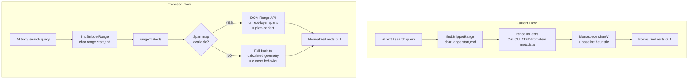

# Plan: Pixel-Perfect AI Annotation Positioning

## Problem

AI auto-annotations and search highlights are positioned using **calculated geometry** from PDF text-item metadata, which has two sources of error:

1. **Horizontal**: `charW = item.width / len` assumes uniform character width (monospace model)
2. **Vertical**: `baseY +/- h * {0.2, 0.85}` guesses the glyph box from the baseline

Manual highlights don't have this problem because they read `range.getClientRects()` from the browser's rendered text layer, which uses real glyph metrics.

## Solution Strategy

**Use the rendered PDF.js text-layer DOM spans as the source of truth for geometry.**

PDF.js already solves glyph positioning perfectly when it renders the text layer (transparent `<span>` elements positioned with CSS transforms). We read those span positions instead of calculating them.

When text-layer spans are available (page rendered): use DOM geometry (pixel-perfect).
When not available (page not yet rendered): fall back to current calculation (existing behavior).

This fix improves both AI auto-annotations AND search match highlighting, since both call `rangeToRects()`.

## Architecture



## Implementation Steps

### Step 1: Capture text-layer span mapping in `pdf-viewer.js`

**File**: [`js/pdf-viewer.js`](js/pdf-viewer.js)

After `renderTextLayer()` completes (around line 157), build a mapping from text-content item index to DOM span element.

PDF.js's `renderTextLayer` accepts a `textDivs` array that it populates with the created span elements. The spans are created in the same order as non-empty `textContent.items`.

Changes:
- Pass a `textDivs: []` array to `renderTextLayer()` (already done at line 155)
- After the promise resolves, iterate through `textContent.items` and `textDivs` in parallel, skipping empty-string items, to build `Map<itemIdx, spanElement>`
- Store this map per-page in a cache array `spanMaps[pageNumber]`
- Clear the cache on zoom/re-render (same lifecycle as `renderedGen`)
- Expose via new method `PDFViewer.getSpanMap(pageNumber)`

```javascript
// New state variable (near line 18):
let spanMaps = []; // 1-indexed: Map<itemIdx, HTMLSpanElement>

// In loadArrayBuffer (near line 54):
spanMaps = new Array(numPages + 1);

// In renderPage, after textLayer.promise resolves (after line 157):
const spanMap = new Map();
let divPtr = 0;
for (let i = 0; i < textContent.items.length; i++) {
  const item = textContent.items[i];
  if (!item || !item.str || !item.str.length) continue;
  if (divPtr < textLayer.textDivs.length) {
    spanMap.set(i, textLayer.textDivs[divPtr]);
    divPtr++;
  }
}
spanMaps[pageNumber] = spanMap;

// In setScale (near line 200):
spanMaps = new Array(numPages + 1);

// New public method:
function getSpanMap(pageNumber) { return spanMaps[pageNumber] || null; }
```

**Note**: The `textLayer` object returned by `renderTextLayer` has a `textDivs` property. Need to verify the exact property name in the PDF.js version used. If not available, query `textLayerDiv.querySelectorAll('span')` and match by text content order.

### Step 2: Rewrite `rangeToRects()` in `text-geometry.js`

**File**: [`js/text-geometry.js`](js/text-geometry.js)

Add an optional `spanMap` parameter. When a span exists for a text item, use the DOM Range API for pixel-perfect sub-span positioning.

New signature:
```javascript
function rangeToRects(idx, start, end, vp, spanMap)
```

Logic per text-item group `(itemIdx, lo, hi)`:

```javascript
const span = spanMap ? spanMap.get(Number(k)) : null;
if (span && span.firstChild) {
  // --- DOM-based geometry (pixel-perfect) ---
  const wrapper = span.closest('.page-wrapper');
  const wrapperRect = wrapper.getBoundingClientRect();

  // Use Range API for sub-span character precision
  const range = document.createRange();
  const textNode = span.firstChild;
  range.setStart(textNode, Math.min(lo, textNode.length));
  range.setEnd(textNode, Math.min(hi + 1, textNode.length));
  const subRects = range.getClientRects();

  for (const sr of subRects) {
    if (sr.width < 1 || sr.height < 1) continue;
    rects.push({
      x: (sr.left - wrapperRect.left) / wrapperRect.width,
      y: (sr.top - wrapperRect.top) / wrapperRect.height,
      width: sr.width / wrapperRect.width,
      height: sr.height / wrapperRect.height,
    });
  }
} else {
  // --- Calculated fallback (current behavior) ---
  // ... existing code using item.transform, charW, baseY, etc.
}
```

**Key advantages of DOM Range API**:
- Handles proportional fonts perfectly (browser knows real glyph widths)
- Handles multi-line text within a single span (returns multiple rects)
- Eliminates baseline heuristic entirely (uses real rendered bounds)
- Same mechanism that makes manual highlights pixel-perfect

**Fallback safety**: If `range.getClientRects()` returns empty rects (e.g., span not visible, display:none), fall through to the calculated path.

### Step 3: Wire up in `auto-annotate.js`

**File**: [`js/auto-annotate.js`](js/auto-annotate.js)

In the `run()` function, after getting the viewport (around line 179), also get the span map:

```javascript
const vp = baseVp.clone({ scale: PDFViewer.getScale() });
const spanMap = PDFViewer.getSpanMap(pg.page); // NEW
```

Then pass it to `rangeToRects()` (around line 221):

```javascript
const rects = TextGeometry.rangeToRects(idx, range.start, range.end, vp, spanMap); // add spanMap
```

### Step 4: Wire up in `search.js`

**File**: [`js/search.js`](js/search.js)

In `matchRects()` (line 52), pass the span map:

```javascript
function matchRects(page, start, end, vp) {
  const idx = pageIndices.get(page);
  if (!idx) return [];
  const spanMap = PDFViewer.getSpanMap(page); // NEW
  return TextGeometry.rangeToRects(idx, start, end, vp, spanMap); // add spanMap
}
```

### Step 5: Handle "page not rendered" edge case

When auto-annotate runs on a page that hasn't been rendered yet, `getSpanMap()` returns `null`, and `rangeToRects()` falls back to the calculated path.

**Option A (recommended for now)**: Accept the fallback. Most auto-annotate runs target visible/recently-rendered pages. The fallback is the current behavior, so no regression.

**Option B (future enhancement)**: Force-render the page before annotating. Call `PDFViewer.renderPage(pg.page)` and await it before processing. This guarantees span maps are available but adds latency.

The plan recommends Option A for initial implementation. Option B can be added later behind a setting if needed.

## Files Changed

| File | Change |
|------|--------|
| [`js/pdf-viewer.js`](js/pdf-viewer.js) | Capture span map after text layer render; expose `getSpanMap()` |
| [`js/text-geometry.js`](js/text-geometry.js) | Add `spanMap` param to `rangeToRects()`; DOM Range API path |
| [`js/auto-annotate.js`](js/auto-annotate.js) | Pass span map to `rangeToRects()` |
| [`js/search.js`](js/search.js) | Pass span map to `rangeToRects()` |

## Risk Assessment

- **Low risk**: The calculated fallback preserves current behavior when spans aren't available
- **No data migration**: Annotation storage format (normalized 0..1 rects) is unchanged
- **No UI changes**: Rendering layer (`drawAnnotation()`) is untouched
- **Benefits both features**: Search highlighting also becomes pixel-perfect
- **Edge case**: If PDF.js span ordering doesn't match text-content item ordering, the span map could be wrong. Mitigation: validate by comparing span text content to item strings during map building; skip mismatched entries

## Testing Checklist

- [ ] AI annotation on a visible page matches text exactly (horizontal + vertical)
- [ ] AI annotation on a non-rendered page falls back gracefully (no crash, same as before)
- [ ] Search highlights match text exactly on rendered pages
- [ ] Zoom in/out: annotations stay correctly positioned (normalized coords)
- [ ] Multi-line AI passages produce multiple rects (one per visual line)
- [ ] PDFs with proportional fonts (most common) show clear improvement
- [ ] PDFs with monospace fonts show no regression
- [ ] AI annotations created at one zoom level are correct at another zoom level
