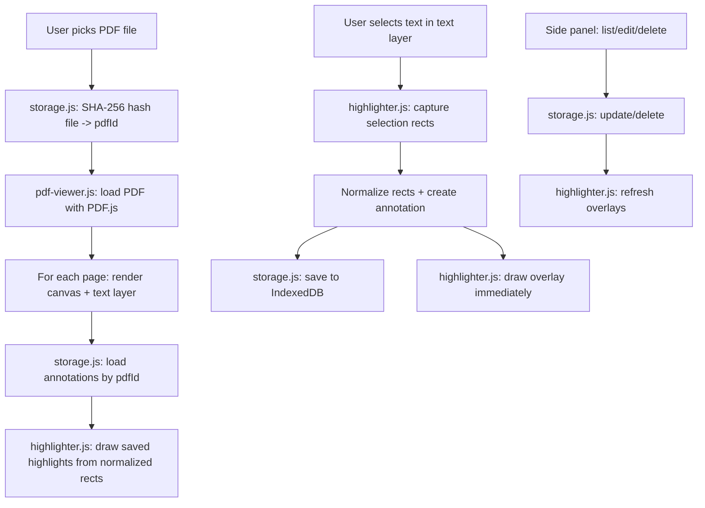

# PDF Annotations — Architecture & Plan

## Goal
A 100% client-side, offline browser app to load local PDFs, highlight selected text,
and attach optional annotations. Annotations are stored separately in IndexedDB and
re-drawn at their exact location when a PDF is reopened.

## Confirmed Decisions
| Concern | Decision |
|---|---|
| Runtime | Browser JavaScript (no server) |
| Build | **None** — plain vanilla JS, local PDF.js files, open `index.html` |
| PDF engine | **PDF.js** (local prebuilt files) |
| Storage | **IndexedDB** (annotations stored separately from the PDF) |
| Highlight persistence | **Re-draw at exact location** on reopen (store page + normalized rects) |
| Offline | All assets local; no CDN, no external API |

## Tech Stack & Versions
- **PDF.js v3.11.174** (`pdfjs-dist`) — the last v3 line that ships a UMD/global build
  (`build/pdf.min.js` exposing `window.pdfjsLib` + `build/pdf.worker.min.js`).
  This lets us use classic `<script src>` tags (no ES modules), which is the most
  reliable way to run by simply opening `index.html`.
- **IndexedDB** via a small hand-written promise wrapper (no library).
- **SubtleCrypto** (`crypto.subtle`) to SHA-256 hash the file → stable `pdfId` so the
  same PDF always maps to its annotations across sessions.
- **crypto.randomUUID()** for annotation IDs.

> Files to download locally into `lib/`:
> `pdf.min.js`, `pdf.worker.min.js` (and the text-layer CSS rules copied into our stylesheet).

## How "open index.html" + offline works
- Classic scripts (no ES modules) avoid `file://` module CORS issues.
- `pdfjsLib.GlobalWorkerOptions.workerSrc` is set to the local worker file.
  - Served via a simple local server (recommended, e.g. `npx serve` or
    `python -m http.server`) → real worker thread.
  - Opened directly via `file://` → if the browser blocks the worker, PDF.js falls
    back to its "fake worker" on the main thread (slower but functional).

## File Structure
```
pdfAnnotations/
├── index.html              # App shell: toolbar, viewer, side panel
├── css/
│   └── styles.css          # Layout + PDF.js text-layer rules + highlight styles
├── js/
│   ├── app.js              # Bootstrap, wires modules together, event hub
│   ├── pdf-viewer.js       # Load PDF, render pages (canvas + text layer), zoom/nav
│   ├── highlighter.js      # Capture text selection, draw/re-draw highlight overlays
│   ├── search.js           # Full-PDF text search (find, navigate, match overlays)
│   ├── storage.js          # IndexedDB wrapper (annotations + pdf metadata)
│   └── annotations-ui.js   # Side panel list, add/edit/delete notes, export/import
├── lib/
│   ├── pdf.min.js          # PDF.js core (downloaded, local)
│   └── pdf.worker.min.js   # PDF.js worker (downloaded, local)
└── plans/
    └── plan.md
```

## Data Model

### Annotation record (stored in IndexedDB)
```js
{
  id:            "uuid",            // crypto.randomUUID()
  pdfId:         "sha256-hex",      // links annotation to a specific PDF file
  page:          1,                 // 1-based page number
  textSelected:  "the highlighted text",
  rects: [                          // NORMALIZED to page size (0..1), scale-independent
    { x, y, width, height }
  ],
  annotationText: "optional note" | null,
  color:         "#ffd400",         // highlight color (single color for v1)
  createdAt:     1690000000000,
  updatedAt:     1690000000000
}
```
Normalized rects (fractions of page width/height) let highlights re-draw correctly
at any zoom level and survive viewport changes.

### PDF metadata record (optional, for the "recent files" UX)
```js
{ pdfId, fileName, numPages, lastOpened }
```

## IndexedDB Schema
- Database: `pdfAnnotationsDB` (version 1)
- Object store `annotations` — keyPath `id`
  - Index `by_pdf` on `pdfId`
  - Index `by_pdf_page` on `[pdfId, page]`
- Object store `pdfs` — keyPath `pdfId`

## Architecture / Data Flow



## Per-Page DOM Structure
Each page is a container holding three stacked layers:
```
.page-wrapper (position: relative)
├── canvas          (PDF pixels)
├── .highlight-layer (absolutely positioned highlight divs)
└── .text-layer     (transparent text for native selection)
```
- Text layer sits on top so the browser handles selection natively.
- Highlight layer sits between canvas and text layer; pointer-events pass through
  except on highlight divs (clickable to edit).

## Core Interaction Flows
1. **Highlight**: select text → floating "Highlight" button → capture
   `selection.getRangeAt(0).getClientRects()` → normalize by page size → save → draw.
2. **Add note**: click a highlight → editor in side panel → type `annotationText` → save.
3. **Navigate**: click an item in the side panel → scroll to page → flash the highlight.
4. **Delete**: delete from side panel → remove overlay + IndexedDB record.
5. **Zoom**: re-render canvas + text layer at new scale; highlights re-scale from
   normalized rects (no re-capture needed).
6. **Export/Import**: download JSON for current `pdfId` / upload JSON to merge.
7. **Find in PDF** (full-text search): type in the toolbar search box → builds a per-page
   text index from `getTextContent` → matches across the whole document → draws match
   overlays (active match highlighted) + prev/next navigation (`Enter`/`Shift+Enter`),
   `Ctrl+F` to focus, `Esc` to clear. Matches are recomputed from text-item geometry so
   they stay correct after zoom.

## Step-by-Step TODO List
1. Download PDF.js v3.11.174 prebuilt files into `lib/` (`pdf.min.js`, `pdf.worker.min.js`).
2. Create `index.html` app shell (toolbar, viewer area, side panel) with classic script tags.
3. Create `css/styles.css` (layout + PDF.js text-layer rules + highlight styles).
4. Implement `js/storage.js` — IndexedDB wrapper (open DB, CRUD annotations, pdf metadata, by-pdf/page queries).
5. Implement `js/pdf-viewer.js` — load PDF via PDF.js, render pages (canvas + text layer), zoom & page navigation, set workerSrc.
6. Implement `js/highlighter.js` — capture text selection, normalize rects, draw/re-draw highlight overlays, click-to-edit.
7. Implement `js/annotations-ui.js` — side panel list, add/edit/delete notes, export/import JSON, jump-to-highlight.
8. Implement `js/app.js` — bootstrap, wire modules, file-input handler, SHA-256 pdfId, load-on-open highlights.
9. Manual test: open via local server + via file://, highlight, annotate, reopen, zoom, export/import.

## Risks & Considerations
- **`file://` worker**: may fall back to main-thread fake worker; document that a local
  server gives best performance.
- **Text-layer API drift**: v3.x uses `pdfjsLib.renderTextLayer`; pin the version so the
  API stays stable.
- **Selection rect mapping**: rects must be converted from viewport coords to the page
  wrapper's local coords before normalizing — handle page scroll/offset carefully.
- **Large PDFs**: render pages lazily (on scroll into view) rather than all at once.
