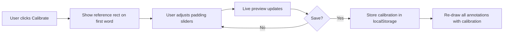

# Plan: Rectangle Calibration Feature

## Problem

When annotations are created (especially via Auto-Annotate / AI), the highlight rectangles don't perfectly cover the visible text. This happens because:

1. **Calculated fallback path** in [`rangeToRects()`](js/text-geometry.js:66) uses heuristics:
   - `charW = item.width / len` assumes uniform character widths (line 119)
   - Y bounds: `baseY - h * 0.2` to `baseY + h * 0.85` are approximate (line 125)
2. **DOM-based path** (lines 89-114) is pixel-perfect but only works when the page is already rendered with text-layer spans

## Recommended Approach: Global Padding Calibration at Draw Time

A **padding-based calibration** applied in [`drawAnnotation()`](js/highlighter.js:191) — the single chokepoint where ALL annotation rects are rendered to the DOM.

### Why this approach:
- **Universal** — works for all annotations regardless of creation method (manual, auto-annotate, AI panel)
- **Non-destructive** — doesn't modify stored rect data, only adjusts visual rendering
- **Easy to calibrate** — adjust padding until a reference rectangle looks right
- **Handles both size and position issues** — padding can grow/shrink and shift rects

### How it works:



## Implementation Steps

### Step 1: Add calibration state to Highlighter module

In [`js/highlighter.js`](js/highlighter.js):

```javascript
// Calibration settings (fractions of rect dimension)
let calibration = {
  padTop: 0,      // e.g. 0.1 = add 10% of rect height above
  padBottom: 0,
  padLeft: 0,
  padRight: 0,
};

function setCalibration(c) {
  calibration = { ...calibration, ...c };
  // Re-draw all visible pages
  const n = PDFViewer.getNumPages();
  for (let i = 1; i <= n; i++) redrawPage(i);
}

function getCalibration() { return { ...calibration }; }

function applyCalibration(r) {
  const dx = r.width * calibration.padLeft;
  const dy = r.height * calibration.padTop;
  return {
    x: r.x - dx,
    y: r.y - dy,
    width: r.width * (1 + calibration.padLeft + calibration.padRight),
    height: r.height * (1 + calibration.padTop + calibration.padBottom),
  };
}
```

### Step 2: Apply calibration in drawAnnotation()

In [`drawAnnotation()`](js/highlighter.js:191), modify the rect rendering loop:

```javascript
ann.rects.forEach((r, idx) => {
  const cr = applyCalibration(r);  // <-- apply calibration
  const div = document.createElement('div');
  div.className = 'highlight-rect';
  // ... use cr instead of r for positioning
  div.style.left   = (cr.x * 100) + '%';
  div.style.top    = (cr.y * 100) + '%';
  div.style.width  = (cr.width * 100) + '%';
  div.style.height = (cr.height * 100) + '%';
  // ...
});
```

### Step 3: Add calibration UI in index.html

Add a calibration overlay/modal near the editor popover:

```html
<div id="calibrateOverlay" class="calibrate-overlay" hidden>
  <div class="calibrate-panel">
    <h3 data-i18n="calibrate.title">Calibrate Highlight Size</h3>
    <p class="calibrate-hint" data-i18n="calibrate.hint">
      Adjust padding until the yellow rectangle perfectly covers the reference text.
    </p>

    <div class="calibrate-row">
      <label data-i18n="calibrate.top">Top</label>
      <button class="cal-btn" data-cal="padTop" data-dir="-1">−</button>
      <input type="range" id="calTop" min="-0.5" max="0.5" step="0.01" value="0">
      <button class="cal-btn" data-cal="padTop" data-dir="1">+</button>
    </div>
    <div class="calibrate-row">
      <label data-i18n="calibrate.bottom">Bottom</label>
      <button class="cal-btn" data-cal="padBottom" data-dir="-1">−</button>
      <input type="range" id="calBottom" min="-0.5" max="0.5" step="0.01" value="0">
      <button class="cal-btn" data-cal="padBottom" data-dir="1">+</button>
    </div>
    <div class="calibrate-row">
      <label data-i18n="calibrate.left">Left</label>
      <button class="cal-btn" data-cal="padLeft" data-dir="-1">−</button>
      <input type="range" id="calLeft" min="-0.5" max="0.5" step="0.01" value="0">
      <button class="cal-btn" data-cal="padLeft" data-dir="1">+</button>
    </div>
    <div class="calibrate-row">
      <label data-i18n="calibrate.right">Right</label>
      <button class="cal-btn" data-cal="padRight" data-dir="-1">−</button>
      <input type="range" id="calRight" min="-0.5" max="0.5" step="0.01" value="0">
      <button class="cal-btn" data-cal="padRight" data-dir="1">+</button>
    </div>

    <div class="calibrate-actions">
      <button id="calReset" data-i18n="calibrate.reset">Reset</button>
      <button id="calSave" class="primary" data-i18n="calibrate.save">Save</button>
      <button id="calClose" data-i18n="calibrate.close">Close</button>
    </div>
  </div>
</div>
```

### Step 4: Add calibration logic in app.js

Wire up the calibration UI:

1. **Open calibration**: When user clicks a "Calibrate" button (in toolbar or editor popover), show the overlay and render a reference rectangle on the first text item of the current page.
2. **Live preview**: On slider/button change, update `calibration` and re-draw the reference rect + all annotations.
3. **Save**: Store calibration in `localStorage` keyed by `currentPdfId`.
4. **Load**: On PDF load, read saved calibration and apply it.

```javascript
// Storage helpers
function saveCalibration(pdfId, cal) {
  localStorage.setItem('calibration_' + pdfId, JSON.stringify(cal));
}
function loadCalibration(pdfId) {
  const raw = localStorage.getItem('calibration_' + pdfId);
  return raw ? JSON.parse(raw) : null;
}
```

### Step 5: Add CSS for calibration overlay

In [`css/styles.css`](css/styles.css):

```css
.calibrate-overlay {
  position: fixed;
  bottom: 20px;
  right: 20px;
  z-index: 1000;
}
.calibrate-panel {
  background: var(--panel-bg, #1e1e2e);
  border: 1px solid var(--border, #333);
  border-radius: 8px;
  padding: 16px;
  width: 320px;
  box-shadow: 0 4px 20px rgba(0,0,0,0.4);
}
.calibrate-row {
  display: flex;
  align-items: center;
  gap: 8px;
  margin: 8px 0;
}
.calibrate-row label {
  width: 60px;
  font-size: 13px;
}
.calibrate-row input[type="range"] {
  flex: 1;
}
.cal-btn {
  width: 28px;
  height: 28px;
  border: 1px solid var(--border, #555);
  background: var(--bg, #2a2a3e);
  color: var(--text, #e0e0e0);
  border-radius: 4px;
  cursor: pointer;
  font-size: 16px;
}
.calibrate-actions {
  display: flex;
  gap: 8px;
  margin-top: 12px;
  justify-content: flex-end;
}
```

### Step 6: Add i18n translations

In [`js/i18n.js`](js/i18n.js), add keys for both `en` and `pt-BR`:

```javascript
// English
'calibrate.title': 'Calibrate Highlight Size',
'calibrate.hint': 'Adjust padding until the yellow rectangle perfectly covers the reference text.',
'calibrate.top': 'Top',
'calibrate.bottom': 'Bottom',
'calibrate.left': 'Left',
'calibrate.right': 'Right',
'calibrate.reset': 'Reset',
'calibrate.save': 'Save',
'calibrate.close': 'Close',
'calibrate.button': 'Calibrate',

// Portuguese
'calibrate.title': 'Calibrar Tamanho do Realce',
'calibrate.hint': 'Ajuste o preenchimento até que o retângulo amarelo cubra perfeitamente o texto de referência.',
'calibrate.top': 'Superior',
'calibrate.bottom': 'Inferior',
'calibrate.left': 'Esquerda',
'calibrate.right': 'Direita',
'calibrate.reset': 'Redefinir',
'calibrate.save': 'Salvar',
'calibrate.close': 'Fechar',
'calibrate.button': 'Calibrar',
```

### Step 7: Add "Calibrate" button trigger

Add a small button in the toolbar or in the editor popover (next to the expand arrows) that opens the calibration overlay.

## Alternative Considered: Character Spacing Parameter

The user also suggested "a param of blank spacing between characters." This would modify `charW` in the calculated fallback path:

```javascript
// In rangeToRects calculated fallback:
const charW = item.width ? item.width / len * charSpacingFactor : 0;
```

**Pros**: Directly addresses the root cause in calculated rects.
**Cons**: Only helps the calculated fallback path (not DOM-based), and character spacing varies within a single text line (proportional fonts). A single multiplier can't fix all cases.

**Recommendation**: Use the padding calibration approach as the primary solution since it's universal and handles both position and size issues. The character spacing parameter could be added later as a secondary fine-tune if needed.

## Files to Modify

| File | Change |
|------|--------|
| [`js/highlighter.js`](js/highlighter.js) | Add calibration state, `applyCalibration()`, `setCalibration()`, modify `drawAnnotation()` |
| [`index.html`](index.html) | Add calibration overlay HTML + trigger button |
| [`css/styles.css`](css/styles.css) | Add calibration overlay styles |
| [`js/app.js`](js/app.js) | Wire calibration UI, save/load from localStorage |
| [`js/i18n.js`](js/i18n.js) | Add calibration translations (en + pt-BR) |
